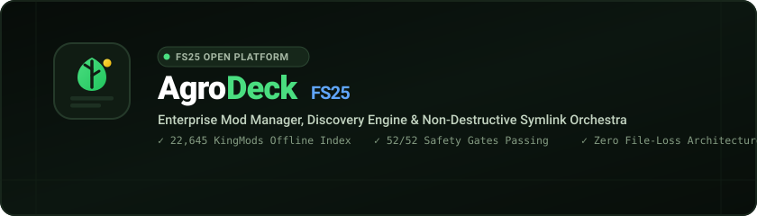
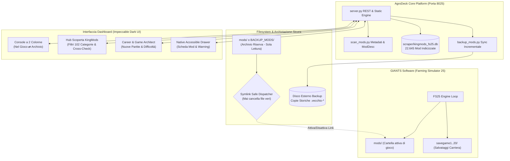

<p align="center">
  
</p>

<p align="center">
  <strong>Console Operativa Enterprise &amp; Discovery Hub per Farming Simulator 25</strong><br>
  Architettura non distruttiva a collegamenti simbolici (symlink), catalogo offline di oltre 22.000 mod KingMods e gestione avanzata delle carriere.
</p>

<p align="center">
  
  
  
  
  
  
</p>

---

## 📐 Architettura di Sistema



---

## ⚡ Caratteristiche Principali

### 1. 🎛️ Console di Gestione a Due Colonne
* **Colonna Sinistra (Nel Gioco)**: panoramica esatta delle mod attualmente attive nel gioco.
* **Colonna Destra (Archivio / Riserva)**: catalogo ordinabile di tutte le mod scaricate o archiviate.
* **Azioni Rapide a 1-Click**: pulsanti `+ Aggiungi` e `✕ Rimuovi` con aggiornamento in tempo reale e barra di applicazione sticky con salvataggio delle transazioni.

### 2. 🔍 Hub di Ricerca KingMods (22.645 Mod Indicizzate)
* **Ricerca Sub-millisecondo (SQLite Locale)**: cerca istantaneamente tra oltre 22.000 mod FS25 per nome, marca, autore o descrizione.
* **Cross-Check con il tuo Archivio**:
  * `🟢 Nel Gioco`: la mod è già abilitata nella tua sessione corrente.
  * `✓ In Archivio`: la mod è presente nel tuo archivio locale/backup.
  * `⭐ Nuova`: mod esterna non ancora presente, con collegamento diretto alla scheda KingMods.
* **Preset Tematici Rapidi**:
  * 🇮🇹 *Made in Italy & Mediterraneo* (Fiat, Laverda, Same, Landini, Carraro, Alpego, mappe Etruria/Polesine).
  * ⚙️ *Script & Realismo Indispensabili* (Universal Autoload, Courseplay, AutoDrive, TerraFarm).
  * 🏆 *Top Download di Sempre* (le mod più celebri e collaudate al mondo).
  * 🚜 *Trattori Iconici* (compatti, medi e giganti da lavoro).
  * 🏭 *Produzioni & Fabbriche* (serre, filiere e magazzini).
  * 🗺️ *Mappe Europee* (scenari collinari e campagne aperte).
* **Filtro Categorie**: menu con 102 categorie FS25 con conteggi reali.

### 3. 🛡️ Sicurezza Assoluta (Zero File-Loss)
* **52 Test Automatizzati** (`make test`) a protezione di percorsi, directory traversal e salvataggi.
* Non tocca mai i file `.zip` originali: opera esclusivamente tramite link simbolici.
* Blocco automatico di qualsiasi operazione mentre Farming Simulator 25 è in esecuzione.
* Backup con versioning incrementale (`.vecchio-<data>`) per preservare ogni configurazione.

---

## 🚀 Avvio Rapido

### Metodo 1: Makefile (Consigliato su Linux)

```bash
# Avvia il server e apre la dashboard nel browser
make run
```

Per consultare tutti i comandi:
```bash
make help
make status
```

### Metodo 2: Docker Compose (Universale su Windows / Linux / macOS)

```bash
# Avvia in background
docker compose up -d

# Oppure tramite Makefile
make docker-run
```

La dashboard sarà attiva su `http://127.0.0.1:8025`.

---

## ⚙️ Configurazione Percorsi

Se utilizzi percorsi personalizzati, puoi configurare AgroDeck tramite il file `data/config.json`:

```bash
cp data/config.example.json data/config.json
```

```json
{
  "active_game_dir": "/percorso/alle/tue/mod",
  "wine_game_root": "/percorso/ai/tuoi/salvataggi/FarmingSimulator2025",
  "game_launcher": "/percorso/al/tuo/run.sh",
  "archive_dir": "/percorso/al/tuo/archivio/mods",
  "kingmods_db": "/percorso/a/kingmods_fs25.db",
  "backup_disco": "/percorso/al/disco/di/backup"
}
```

In alternativa, puoi esportare le variabili d'ambiente:
```bash
export FS25_MODS_DIR="/percorso/alle/tue/mod"
export FS25_ARCHIVE_DIR="/percorso/all/archivio"
make run
```

---

## 🧪 Validazione & Test di Sicurezza

```bash
make test
```
Tutti i 52 test verificano:
- Protezione dell'archivio da cancellazioni.
- Rifiuto di percorsi traversali (`../`).
- Convalida salvataggi e prevenzione conflitti slot.
- Sanitizzazione dei metadati e dei file CSV.

---

## 📄 Licenza

Distribuito sotto licenza **MIT**. Consulta il file [LICENSE](LICENSE) per i dettagli.
